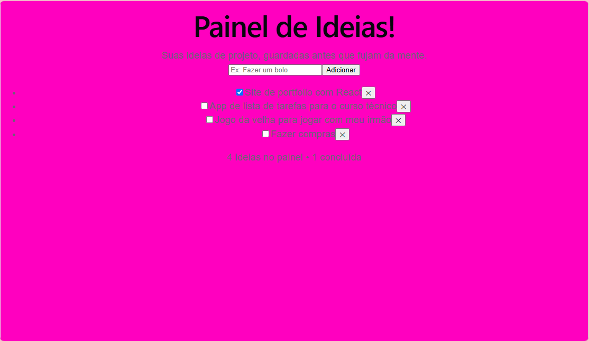
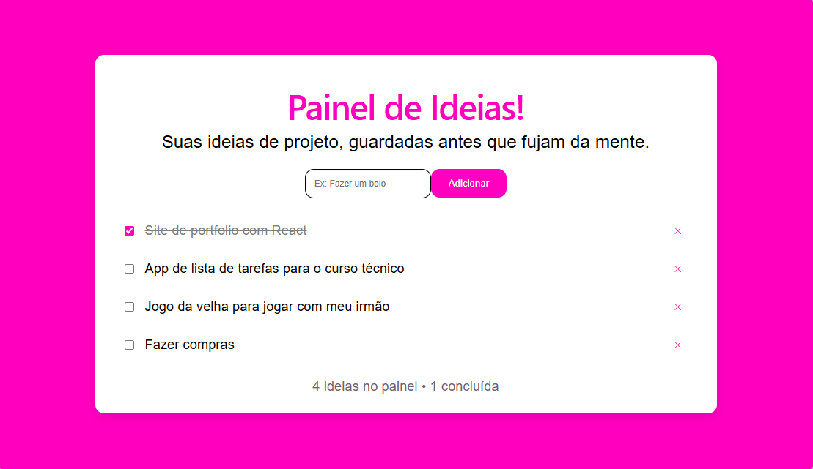
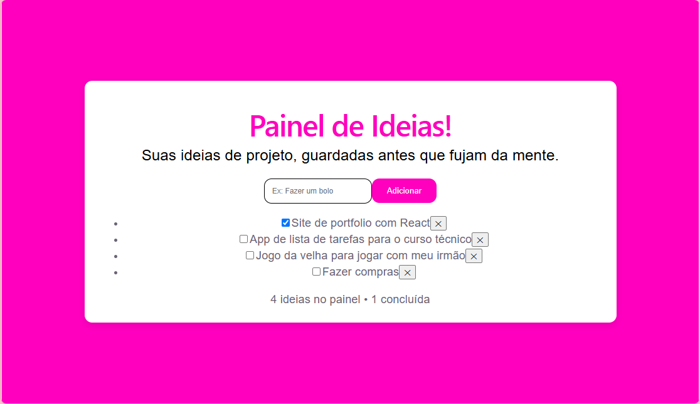
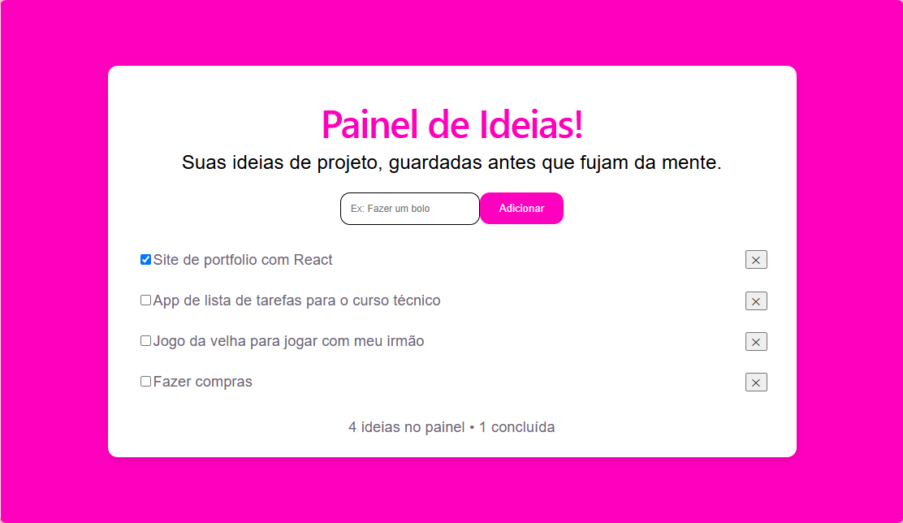
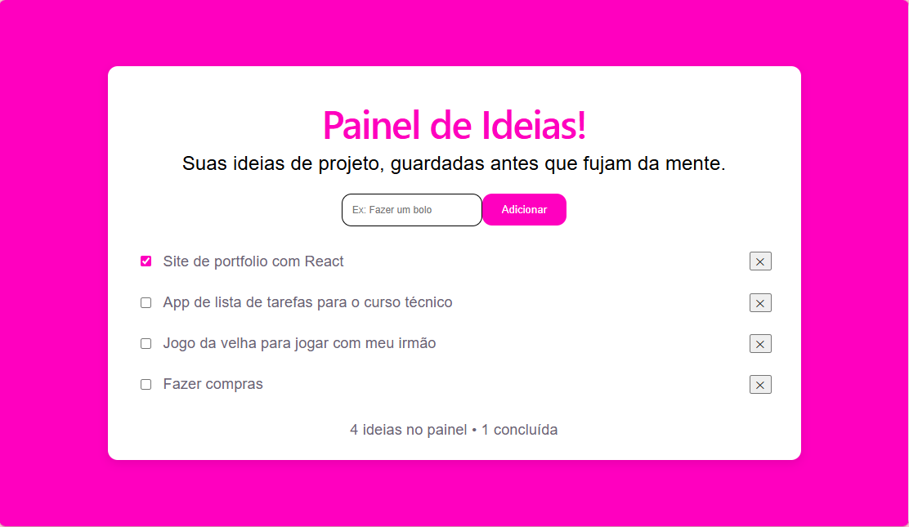
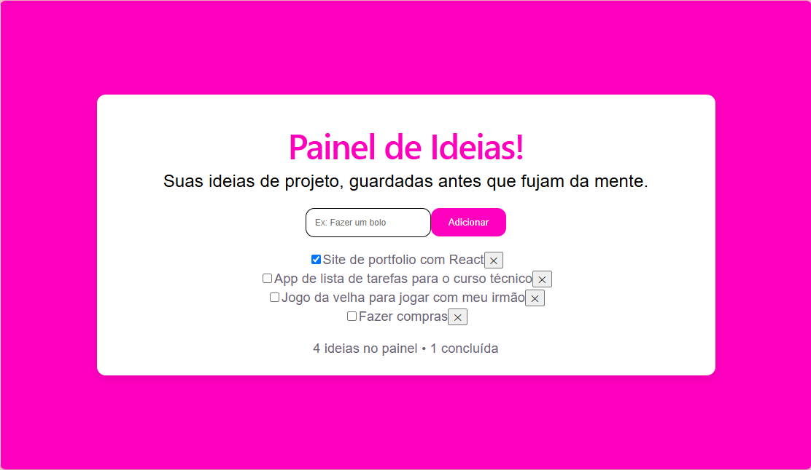
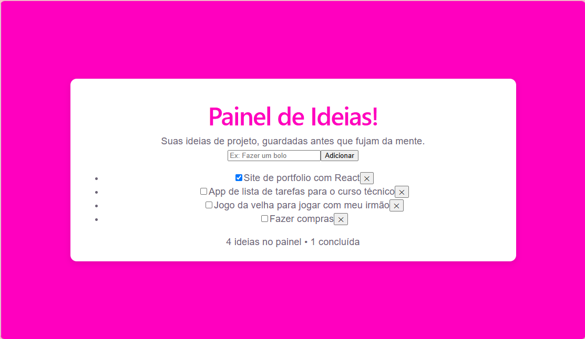
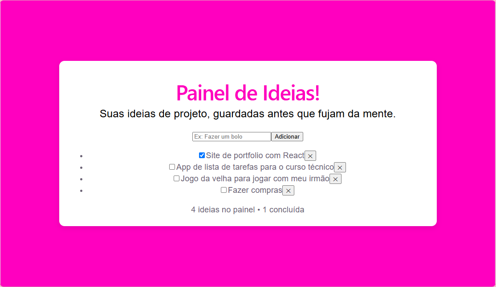
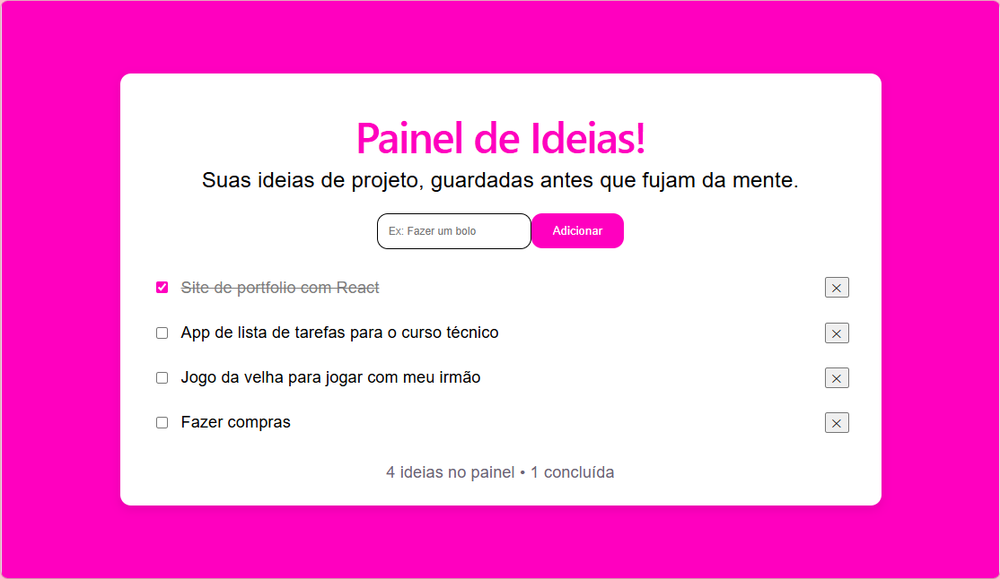

# Painel de Ideias

Este projeto é um painel para gerenciar ideias, desenvolvido com React e estilizado com CSS passo a passo.

## Evolução do Design (Passo a Passo)

### 1. Estilização do Corpo (Body)

### 2. Estilização do Botão (Btn)

### 3. Estilização do Formulário (Form)

### 4. Estilização do Item

### 5. Estilização da Label

### 6. Estilização da Lista

### 7. Estilização do Painel

### 8. Estilização do Subtítulo

### 9. Estilização do Texto
